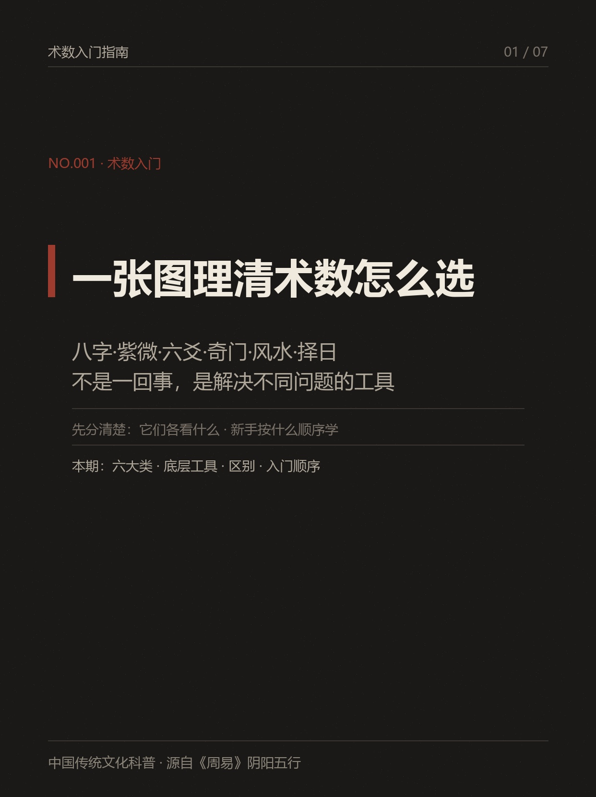
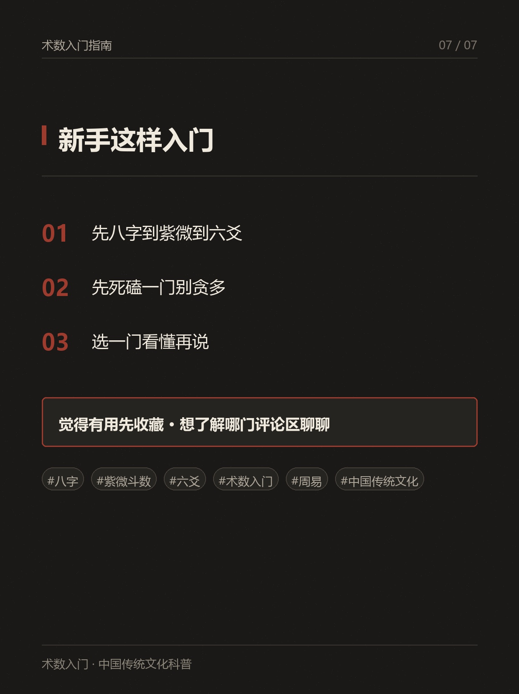

# xhs-writer · 小红书爆款笔记生成器（Agent Skill）

> 一句话 + 一个链接 → 自动产出全套小红书图文：长文原稿、卡片组、caption、hashtags。

xhs-writer 是一个面向 **Agent 环境**（豆包 / Claude 等）的 Skill。你只需给出主题或一条小红书链接，它自动完成：**素材抓取 → 卖点分析 → 搜对标 → 长文原稿 → 去 AI 化 → 拆卡 → 卡片渲染 → caption/hashtags → 落盘 → 校验**。

## 功能特性

- 🔗 **一条链接自动跑全套**：把别人的爆款笔记链接/主题丢进来，自动产出同主题笔记
- 🎨 **多种卡片形态**：9:16 竖版图文卡、3:4 封面、素人感 AI 卡、**代码精排精准卡**（文字 100% 准确，深色高知研究风）
- ✍️ **爆款方法论内置**：卖点分析（稀缺性×实用性×可感知）、5 种标题公式、素人感设计原则
- 🧹 **去 AI 化**：内置 humanizer 五层原则，产出有活人感的文案
- ✅ **强制校验**：`validate_meta.py` 保证 meta 结构合法后才交付
- 📦 **纯本地脚本**：Python + Pillow，无外部 API key 依赖（图生图走宿主 Agent 的图像工具）

## 快速开始

### 环境要求
- Python 3.9+（脚本依赖 Pillow：`pip install Pillow`）
- 宿主 Agent（豆包 / Claude Code 等）

### 安装
1. 把本仓库放入 Agent 的 skills 目录（豆包：`~/.user_skills/`；Claude：`~/.claude/skills/`）
2. 重启 Agent 会话

### 使用
```
写小红书 / 做小红书笔记 / 出一套 xhs 卡片 / 把这篇做成笔记 <粘贴链接>
```

以豆包为例，一条完整请求：
```
https://www.xiaohongshu.com/explore/xxx  这篇做成小红书笔记，跑全流程
```

## 工作流（9 步）

| 步骤 | 环节 | 产物 |
|---|---|---|
| 0 | Intake（主题/读者/形态/风格/数量） | 需求确认 |
| 0.5 | 卖点/亮点分析 | 卖点表 |
| 1 | 素材清点（analyze_material.py） | materials.json |
| 2 | 采集外部参考（搜对标爆款） | 参考摘要 |
| 3 | 写长文原稿（2000-4000 字） | 原稿 .md |
| 4 | 去 AI 化（humanizer 五层原则） | 改写稿 |
| 4.5 | 图生图（seedream / 代码精排） | 卡片图 |
| 5 | 分发（拆卡 3-9 张 / 视频分镜） | 卡片组 |
| 6 | caption + hashtags + 标题 | meta.json |
| 7 | 落盘（normalize_slug.py 命名） | 产物目录 |
| 8 | 校验（validate_meta.py，强制） | clean 通过 |

## 目录结构

```
xhs-writer/
├── SKILL.md                 # Skill 主文件（工作流与规则）
├── LICENSE                  # Apache License 2.0
├── README.md
├── scripts/                 # 本地纯 Python 脚本
│   ├── analyze_material.py  # 素材分类/抽帧 → materials.json
│   ├── normalize_slug.py    # 目录名/时间戳标准化
│   ├── text_on_image.py     # 单图 + 文字叠卡（跨平台中文字体探测）
│   ├── collage_3x4.py       # 2-4 张图拼卡
│   ├── crop_watermark.py    # 去水印
│   └── validate_meta.py     # meta.json 校验（强制）
├── references/              # 方法论参考
│   ├── xiaohongshu-viral-methodology.md  # 爆款方法论
│   ├── humanizer-zh.md      # 去 AI 化五层原则
│   ├── meta-schema.md       # meta 字段规范
│   ├── material-intake.md   # 素材接入规范
│   ├── reference-search.md  # 对标搜索规范
│   ├── image-sourcing.md    # 图源策略
│   └── output-spec.md       # 落盘规范
└── docs/demo/               # 演示图（代码精排卡片示例）
```

## 演示

以下卡片由内置的**代码精排渲染**产出（文字 100% 准确，深色高知研究风，1242×1660）：

| 封面示例 | 尾页示例 |
|---|---|
|  |  |

## 致谢与衍生声明

本项目由 **[@JuneYaooo/xhs-writer-skill](https://github.com/JuneYaooo/xhs-writer-skill)** 改编适配：

- 移除对 OpenAI API key 的依赖，图生图改由宿主 Agent 图像工具（豆包 seedream）完成
- 新增代码精排卡片渲染与深色高知研究风模板
- 脚本适配 Windows / macOS / Linux 跨平台中文字体

原项目同样以 Apache License 2.0 发布，本仓库完整保留其许可声明。使用时请同时保留本声明。

## License

[Apache License 2.0](LICENSE)

## 支持本项目

如果它帮你省了时间，欢迎请作者喝杯咖啡 ☕️

- 打赏链接：（填写你的爱发电 / 赞赏码地址）
- 提 Issue / PR：欢迎改进卡片模板与工作流
